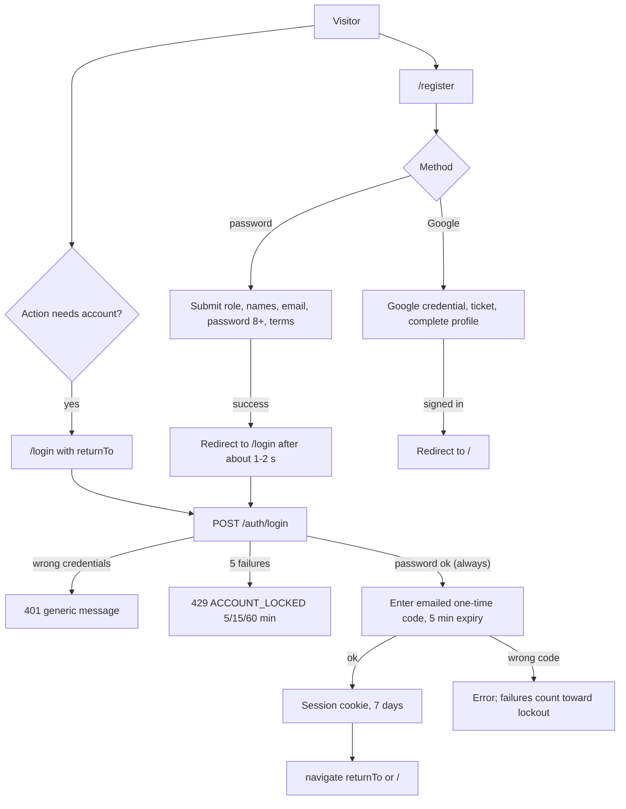
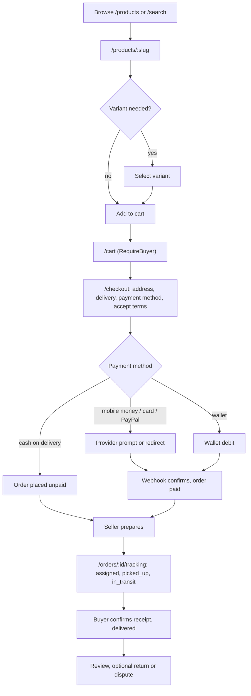
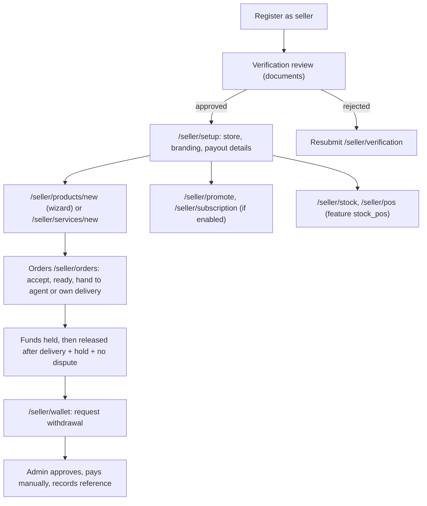

# Application Flow and User Journeys

| Field | Value |
|---|---|
| Audit date | 2026-10-29 |
| Document version | 1.0 |
| Basis | Route tree and guards in `frontend/src/App.jsx` (Verified), login/registration navigation code, backend module behaviour from `product/functional-specification.md`. Journeys were **not walked in a browser** (no Playwright browsers in the sandbox; the project's 3 e2e specs were not run). Treat transitions as code-derived. |
| Companion | `docs/diagrams/application-flow.mmd` (top-level map) |

## 1. Entry points (Verified)

| Entry | Behaviour |
|---|---|
| `/` Home | Hero ("Shop local. Sell local. Delivered to your door."), department rails, recommendations, recently viewed |
| Search (`/search`, header search box) | Product/service search; AI smart search parsing is available |
| Direct links to `/products/:slug`, `/services/:slug`, `/stores/:slug` | Public, prerendered shells for SEO (`scripts/prerender-shells.mjs`) |
| `/sell`, `/how-it-works`, `/about`, `/contact`, `/guides` | Marketing and help content |
| `/login`, `/register`, `/forgot-password` | Authentication |
| Affiliate `?ref=CODE` landings | `AffiliateClickTracker` posts to `/affiliate/click` |
| PWA install | `InstallPrompt` after the cookie notice is acknowledged |

Global chrome: header (hidden on admin and chat-thread routes), footer (hidden on admin, thread, checkout and auth-form routes), cookie consent banner, onboarding tour, floating AI assistant button and support widget, network status notice, update-available banner.

## 2. Authentication and onboarding

Notes: there is **no role-based landing page**; a seller, agent or admin reaches their area by navigating (header menu) after login. `returnTo` is accepted only if it starts with a single `/` (open-redirect guard in `Login.jsx`). Sellers and delivery agents with account verification pending see a review notice (`AccountReviewNotice`) and cannot list or take deliveries until approved. Delivery agents must supply vehicle type and plate at registration.

## 3. Buyer purchase journey

Alternate and error paths: empty cart; insufficient stock (checkout rolls back); payment failure (`payments.status = failed`, buyer can retry); unpaid orders swept by a 15-minute job; cancellation within a window; COD auto-confirmed after 48 h; payment status shown by `PaymentStatusBanner` and live via Socket.IO `payment:updated`.

## 4. Service booking journey

Browse `/services` -> `/services/:slug` -> choose dates/units (availability calendar) -> pay (booking payment, always escrowed) -> provider confirms or rejects (`/seller/bookings`) -> `/bookings/:id` shows progress (`BookingProgressTimeline`) -> completed or cancelled/refunded. Dates with no capacity or closed block the booking atomically.

## 5. Seller journey

## 6. Delivery agent journey

`/delivery` shows available offers -> accept (offer expires if unanswered; platform re-dispatches) -> `/delivery/mine` pick-up and drop-off, location shared in real time, handover by code or photo plus GPS -> `/delivery/earnings` and `/delivery/ratings`; a delivery business owner manages agents at `/delivery/business`.

## 7. Dispute, return and refund journey

Buyer opens `/disputes/new` or `/returns/new` (within 7 or 14 days) -> seller responds within 72 h -> admin reviews (`/admin/disputes`, `/admin/returns`) -> outcome: rejected (release resumes) or refund approved -> refund attempted via provider, else `manual_required` for an admin -> buyer notified.

## 8. Admin journey

Sign in -> `/admin` dashboard (GMV, active users) -> work queues: account verifications, withdrawals, disputes, returns, refunds, fraud, support, EFD, content -> configuration: settings, delivery rates, modules and maintenance, subscriptions and promotions -> oversight: audit logs, users and map, dispatch -> super admin only: admins, data reset.

## 9. Error and system states (Verified in code)

| State | Behaviour |
|---|---|
| Unknown route | `NotFound` (`*`) |
| Wrong role on a guarded page | Message ("This page is for buyer accounts") or redirect; unauthenticated users go to `/login` |
| Module under maintenance | HTTP 503 `MODULE_MAINTENANCE`; `MaintenanceScreen`; `DepartmentMaintenanceListener` |
| Backend suspended account | 403 `ACCOUNT_SUSPENDED` |
| Offline | `NetworkStatusNotice`, service-worker offline fallback |
| New build available | `UpdateAvailableBanner` |
| Render error | `ErrorFallback`, Sentry capture |

## 10. Retired or unreachable flows

`/seller/department-sponsorship` and `/admin/department-sponsorship` redirect to `/seller/promote` and `/admin/sponsorship`. Seller loans have a page file but no route. See `delivery/known-issues.md` (KNOWN-009).
