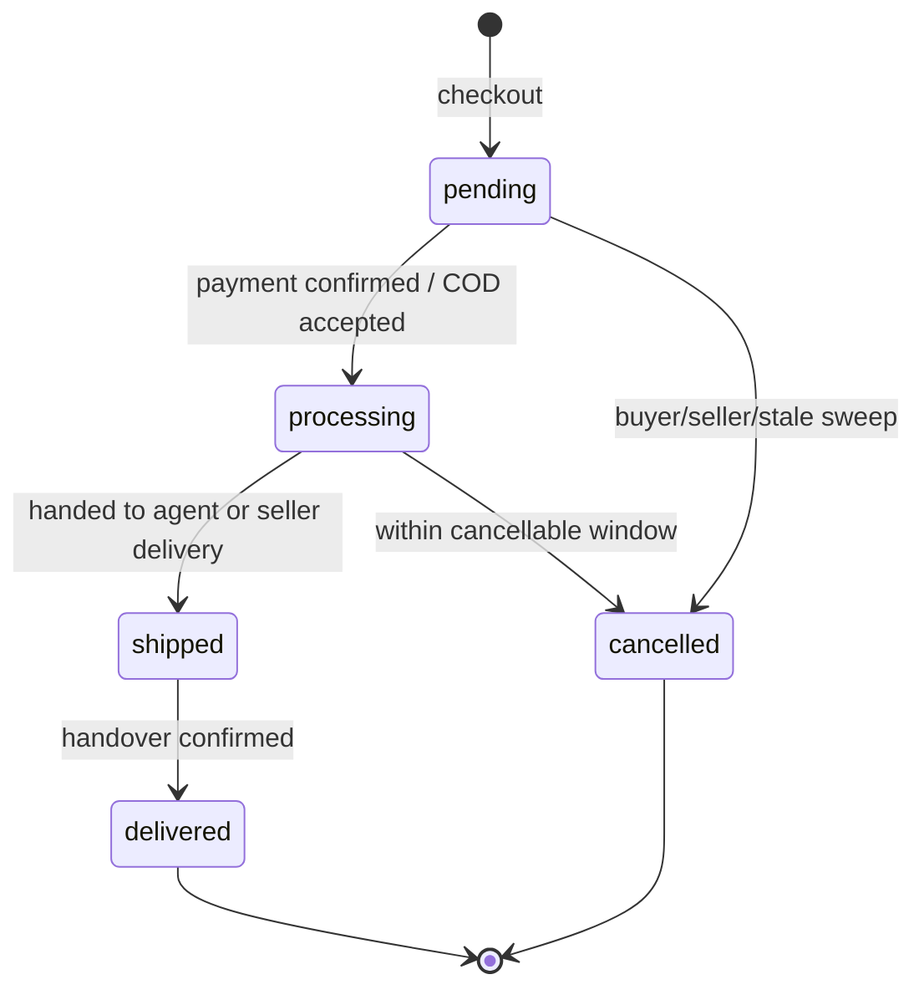
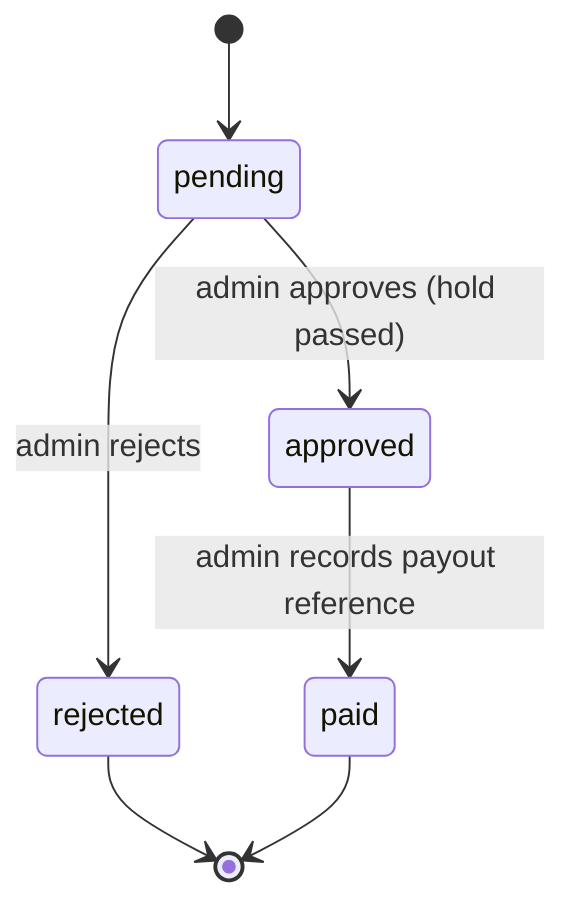

# Functional Specification

| Field | Value |
|---|---|
| Audit date | 2026-10-29 |
| Document version | 1.0 |
| Basis | Code reading (routes, validators, services named per section), live schema enums, passing tests. Behaviours not traced in code are stated as "Not traced". Field-level request/response contracts are in `docs/openapi.yaml` where documented and otherwise Not documented; see `technical/api-documentation.md`. |

IDs: `FR-nnn` functional requirement. Permissions use the role names `buyer`, `seller`, `delivery_agent`, `admin`, `super_admin`.

## 1. Accounts and authentication

| ID | Behaviour | Verified by |
|---|---|---|
| FR-001 | **Register** (`POST /auth/register`). Required: first name, last name, valid email, password 8+ chars, accepted terms, role in buyer/seller/delivery_agent. Optional: username (max 30; reserved words blocked), referral code (max 12), Google ticket. `seller_mode` marketplace or business_tools (business tools only for sellers). Delivery agents must give vehicle type (bicycle, motorcycle, tuktuk, car, van, truck) and plate (max 20). Terms version and acceptance time are stored server-side. | `auth.validator.js`; `auth.register.db.test.js` (5 pass); `auth.login.test.js` |
| FR-002 | **Login** (`POST /auth/login`) is always two-step. Step 1 verifies email and password (unknown email and wrong password both return 401 `INVALID_CREDENTIALS`) and, on success, does **not** issue a session: it emails a one-time code and returns a short-lived (10 min) pre-auth token. Step 2 (`POST /auth/login/verify-otp`) verifies the code and issues the session. OTP: 5-minute expiry, 1-minute resend throttle (`login/resend-otp`, which may choose another channel), max 5 requests per window. Google sign-in does not use this flow. Observation: `docs/openapi.yaml` describes the OTP step as "optional"; the code has no bypass, so the spec is wrong. | `login.service.js`, `auth.controller.js:78`, `otp.service.js`; `auth.login.db.test.js` (7 pass) |
| FR-003 | **Lockout.** Every 5 consecutive failures lock the account for 5, then 15, then 60 minutes; response 429 `ACCOUNT_LOCKED`, including for OTP verify and resend. | `loginLockout.service.js`; `auth.lockout.test.js` |
| FR-004 | **Session.** JWT valid 7 days, delivered as HTTP-only cookie `nexora_session` (Secure and SameSite=None in production, Lax otherwise) and also accepted as Bearer token. A `token_version` mismatch or inactive/suspended account invalidates it on the next request. | `auth.middleware.js`, `sessionCookie.js`; `auth.sessionCookie.test.js` |
| FR-005 | **CSRF.** For cookie-authenticated unsafe requests the `X-CSRF-Token` header must match the `nexora_csrf` cookie; otherwise 403 `CSRF_TOKEN_INVALID`. | `csrf.middleware.js` |
| FR-006 | **Password reset** by OTP; **Google sign-in** (`/auth/google`, `/auth/google/complete`). | Not traced beyond routing; Google untested |
| FR-007 | **Account self-service**: profile, settings (theme light/dark/system, language en/sw), password change by OTP, account deletion (soft, then permanent). | `account.routes.js`, migrations 056-057; `account` tests |
| FR-008 | **Verification and KYC.** Sellers and agents submit documents for review (statuses not_required, pending, approved, rejected); approved sellers only may list; buyers have KYC tiers 0-2 that raise wallet limits; documents are access-controlled and subject to retention. | `accountVerification`, `kyc`, `documentAccess` modules and tests |

## 2. Catalog and discovery

| ID | Behaviour | Notes |
|---|---|---|
| FR-010 | Public browsing of products, categories (departments), store types, stores, services, service categories; search with filters and sort; zero-result searches are recorded for SEO. | `product`, `category`, `search`, `store`, `service` modules; `search` untested |
| FR-011 | Product details: price, discount price, stock, variants with options and price deltas, bulk price tiers, photos and videos (one ordered gallery), Q&A, reviews, wishlist heart, product alerts. | schema; `product`, `productVariant`, `productQuestion`, `productAlert` |
| FR-012 | Seller product creation (wizard): media uploaded directly to Cloudinary using a server-signed request, then registered and ordered; published stock changes only through the stock ledger. Product audio was removed and returns 410 Gone. | `productMedia.controller`, `productAudioRemoved.test.js` (passes) |
| FR-013 | Recommendations are rule-based SQL aggregates (no ML). AI search parsing and product explanations are available to anonymous users under `aiLimiter`. | `recommendation`, `ai` modules |

## 3. Cart and checkout

| ID | Behaviour |
|---|---|
| FR-020 | Cart lines reference a product and optional variant (0 = none). Limits: 100 lines, 500 units per line. |
| FR-021 | Checkout reads the cart (a line is returned only when its product and the seller's `seller_profiles` row exist). Empty cart returns an error. A cart spanning sellers creates a parent order plus one child order per seller; payments, shipping and totals sit on the parent. Stock is decremented in the same transaction; insufficient stock aborts everything. Checkout consent (terms, privacy, refund policy) is required and stored with version. |
| FR-022 | Order types: standard and pre-order (deposit then balance). Delivery modes: platform or seller's own. Payment methods: mobile_money, cash_on_delivery, snippe, malipopay_card, paypal, wallet. |

Transition rules beyond the enum values (`pending, processing, shipped, delivered, cancelled`) - e.g. the exact cancellable window - are **Not traced**; `order.service.cancelOrder` rejects cancelling past that window and other buyers' orders (db test names). Owner confirmation of cancel rules required.

## 4. Payments and money movement

| ID | Behaviour |
|---|---|
| FR-030 | Payment initiation per provider; a `payments` row records method, purpose (order_payment, seller_verification_fee [legacy, fee retired by migration 113], booking_payment, subscription_payment, wallet_topup), leg (full, deposit, balance), status (pending, completed, failed, chargeback), charged currency and an encrypted payer phone for refunds. |
| FR-031 | Completion is accepted only from provider webhooks, verified by signature over the raw body (Snippe, MalipoPay Card, PayPal, WhatsApp `X-Hub-Signature-256`) or by middleware checks (`verifyMalipopayWebhook`, `verifySelcomWebhook` with an optional IP allow-list, `verifySmsWebhook`; Brevo uses a shared-secret header), with a replay guard table. Per-provider details were not re-verified; see `docs/WEBHOOK_VALIDATION.md`. |
| FR-032 | Reconciliation job daily at 04:00 compares provider state; stuck payments enter `payment_review_queue`. |
| FR-033 | Seller credit: net of commission into `held_balance`; release hourly under the three conditions in BR-024; COD credits `balance` directly and debits commission. Every change writes an append-only `wallet_transactions` row (credit/debit; reference types order, withdrawal, adjustment, dispute, escrow_release, booking, cod_commission). |
| FR-034 | Withdrawal: pending, approved, rejected, paid; validation per BR-040 to BR-044; admin enters a payout reference when marking paid. |
| FR-035 | Buyer wallet: top-up (limits BR-045) and spend as a payment method. |

## 5. Delivery

| ID | Behaviour |
|---|---|
| FR-040 | A delivery has status assigned, picked_up, in_transit, delivered, failed, with timestamps for the timeline. |
| FR-041 | Dispatch v2: offers are sent to nearby available agents (`delivery_offers`: offered, accepted, declined, expired); an unanswered offer expires via a BullMQ delayed job (durable with Redis) and a 5-minute rematch job re-dispatches. |
| FR-042 | Agents go online/offline and stream location over Socket.IO (`agent:online`, `agent:location`); buyers join `join_order_tracking` to watch. Routing uses OSRM with a fallback estimate (`routing_provider` osrm or fallback). |
| FR-043 | Handover is confirmed by a pickup code or photo plus GPS; buyers confirm receipt. Agents and delivery businesses see earnings and ratings. |

## 6. Services and bookings

| ID | Behaviour |
|---|---|
| FR-050 | Services have status draft, published, suspended; per-date availability (capacity, price override, open/closed) and pricing rules. |
| FR-051 | Booking statuses: pending, confirmed, active, completed, cancelled, refunded, rejected. Creating a booking decrements availability for every date in one transaction and rolls back if any date lacks units, has no row, or is closed; cancelling restores each date's own quantity. Provider confirms or rejects; hourly lifecycle and 15-minute expiry jobs run. |
| FR-052 | Booking payments are always escrowed (no COD). |

## 7. Trust, disputes, returns, reviews

| ID | Behaviour |
|---|---|
| FR-060 | Disputes: buyer opens against an order item or booking with evidence; messages thread; statuses open, under_review, resolved, rejected, withdrawn; seller response SLA 72 h; admin resolves, optionally triggering a refund. |
| FR-061 | Returns: requested, approved, rejected, shipped_back, received, refunded, cancelled, with evidence and history; window 7 or 14 days. **No tests located for this module.** |
| FR-062 | Refunds: automatic provider refund with up to 3 attempts, else `manual_required`; unique per dispute. |
| FR-063 | Reviews: rating 1-5 enforced by a CHECK constraint, target is a product or a booking (exactly one), photos, seller reply. |
| FR-064 | Fraud flags and wallet reconciliation flags feed the admin fraud dashboard; admin actions are written to `audit_logs`. |

## 8. Communication

FR-070 Conversations and messages with attachments, reactions, soft delete, per-user clear, realtime typing and delivery over Socket.IO (authenticated handshake; `socket.auth.test.js`, `socket.presence.test.js`). FR-071 Notifications: in-app, Web Push (VAPID), email through Brevo with outbox, retry and delivery events, SMS gateway, WhatsApp Cloud API; locale per user. FR-072 Admin broadcasts and admin notification feed. FR-073 Support tickets and messages (`support` module untested).

## 9. Seller growth and tools

FR-080 Subscriptions (BR-002/004) and promotion: sponsorship, featured store. FR-081 Stock and POS: items, movements, adjustments, sales, purchases, expenses, suppliers, customers, reports, import/export, offline sales sync; plans (Classic, Plan, Upgrade pages). FR-082 Group buys, live selling sessions and reminders, affiliate accounts and payouts, referral and loyalty points ledger, collections and saved filters. FR-083 Business verification and tax info (`SellerTaxInfo`), TRA EFD receipts with retry.

## 10. Administration

FR-090 Admin console areas (from routes): dispatch, users and map, deleted accounts, sellers, delivery agents, products, categories, store types, service categories and services, orders, settings (the `platform_settings` keys), withdrawals, subscriptions, featured stores, account verifications, admins, fraud and fraud dashboard, disputes, returns, refunds, support, EFD, pickup points, content, audit logs, data reset (super admin, with approvals), broadcast, delivery rates, maintenance (per-module switches in `platform_modules` plus scheduled windows), status incidents. FR-091 Maintenance mode can disable a module (wallet, wishlist, bookings, chat, disputes, ...) with a message.

## 11. Edge cases and failure paths (Verified in tests unless noted)

| Case | Expected |
|---|---|
| Duplicate checkout submit | One order only (`concurrency.db.test.js`; 2 of 3 pass, the double-submit case fails on fixture drift, KNOWN-005) |
| Replayed webhook | Ignored (`webhookReplayGuard.test.js`, `payment.webhooks.resilience.test.js`) |
| Provider decline on refund | Row `failed`, attempts 3, error stored (`refund.autoRefundForDispute.db.test.js`) |
| Payment with no completed payment on the order | Refund returns `manual_required`, no refund row (same) |
| Withdrawal larger than balance | Rejected, balance unchanged, no orphan wallet row (`wallet.requestWithdrawal.db.test.js`) |
| Redis unavailable | Cache bypassed; dispatch offer expiry falls back to a non-durable in-process timer (boot warning; `docs/DEPLOYMENT.md`) |
| Non-participant sends a chat message | Rejected (`chat.messaging.db.test.js`) |
