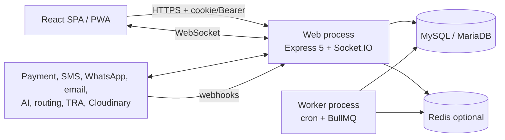

# Software Architecture Document

> **Note 2026-11-11.** Snippe and MalipoPay were removed from the code. The live gateways are AzamPay, Selcom, PawaPay (mobile money and card) and PayPal; references below to the retired two describe the audited state or legacy rows only.

| Field | Value |
|---|---|
| Audit date | 2026-10-29 |
| Document version | 1.0 |
| Basis | Source reading plus the audit's runtime checks (migrations applied, server booted, tests run). Production topology is **Stated** (existing docs), not verified. |
| Related | `docs/ARCHITECTURE_REVIEW.md` (existing system-level map, not re-verified line by line) and `docs/ARCHITECTURE.md` (existing module reference: covers 40 of the 72 modules present and still lists the retired `departmentSponsorship`), `docs/diagrams/architecture.mmd`, `docs/ESCROW_PAYMENT_FLOW.md` |

## 1. Style

A **modular monolith** with a separate worker entry point: one Express 5 codebase (`backend/`, about 68,000 lines, 72 modules), one React SPA (`frontend/`, about 65,000 lines), one relational database. No microservices, message bus or API gateway.

## 2. Components and responsibilities

| Component | Location | Responsibility |
|---|---|---|
| App bootstrap | `backend/src/app.js` (551 lines) | Middleware order, raw-body webhooks, route mounts, health, sitemap, a few direct routes |
| Server | `backend/server.js` | HTTP server, Socket.IO, starts in-process jobs unless disabled |
| Worker | `backend/worker.js` | Cron jobs and BullMQ dispatch worker without HTTP (fatal exit on uncaught exception for clean restart) |
| Modules | `backend/src/modules/<name>/` | Domain slices. Convention: `*.routes.js` (+guards, validation) -> `*.controller.js` (HTTP) -> `*.service.js` (rules, transactions) -> `*.repository.js` (SQL). Counts: 64 routes, 65 controllers, 71 services, 67 repositories, 52 validators. No controller imports the DB pool directly; 34 services do (for transactions and locks). |
| Providers | `modules/payment/providers`, `ai/providers`, `sms/providers`, `whatsapp/providers`, `efd/providers` | Strategy pattern with a registry and a `simulate` provider for non-production; production refuses to fall back silently |
| Middleware | `backend/src/middleware/` | Auth, role, approval, CSRF, locale, rate limit, upload and content validation, webhook auth, maintenance, validation result |
| Jobs | `backend/src/jobs/index.js` (live) | 24 scheduled jobs wrapped in `safeRun` + advisory lock (see KNOWN-003) |
| Queue | `backend/src/queues/dispatchQueue.js` | BullMQ delayed jobs (delivery offer expiry) |
| Realtime | `backend/src/socket/socket.js` | Authenticated handshake; chat, typing, order tracking rooms, agent online/location, offer response |
| Config | `backend/src/config/` | DB pools, Redis, Cloudinary, Brevo, Sentry, web-push, routing, env check |
| Frontend | `frontend/src/` | `App.jsx` routes, `pages/` (139), `components/` (158), `context/` (Auth, Cart, Wishlist, Socket, Language, Theme, Currency, Toast, DataSaver, AIAssistant), `api/` clients, `hooks/`, `i18n/` (en, sw) |
| Database | `database/migrations/` (160) | Forward-only SQL migrations, `migrate.js` runner |

## 3. Request lifecycle (Verified from `app.js`)

1. Trust proxy (hops from env) and CORS (origins from `CORS_ORIGIN`, credentials allowed).
2. Per-response CSP nonce, then `helmet`. The CSP is restrictive (`default-src 'none'`) because the API serves only JSON and one small HTML page.
3. Compression, request logging (`requestLogger.middleware.js`: pino-http; generates or echoes `X-Request-Id`).
4. **Raw-body webhook routes** (Snippe, MalipoPay Card, PayPal, WhatsApp) are registered *before* `express.json()` so signatures can be verified over exact bytes.
5. `express.json`, `urlencoded`, `cookieParser`.
6. CSRF check, locale resolution, `apiLimiter` on `/api/`.
7. Route module: validators -> guards (`authMiddleware`, `authorize`, approvals, feature/maintenance) -> controller -> service -> repository.
8. Error handling and Sentry capture.

## 4. Key data flows

**Order and payment.** Checkout (service, transaction: order rows + stock decrement) -> payment initiation to a provider -> provider webhook (verified, replay-guarded) -> payment `completed`, order `paid` -> seller credit into `held_balance` -> Socket.IO `payment:updated` -> hourly release job -> withdrawal request -> manual admin payout. Diagrams: `docs/ESCROW_PAYMENT_FLOW.md` (existing; schema consistency verified).

**Delivery.** Order ready -> dispatch creates `delivery_offers` for nearby agents -> agent responds over Socket.IO or REST -> offer expiry via BullMQ delayed job (or in-process timer without Redis) and 5-minute rematch job -> agent location events fan out to the order's tracking room -> ETA from OSRM with fallback.

**Media.** Browser asks the API for a signed Cloudinary upload, uploads directly, then registers the asset; uploaded files that pass through the API are checked by content validators and optionally ClamAV.

**Notifications.** Event -> in-app row + Web Push + email through `email_outbox` (retry job every 5 minutes, delivery events from the Brevo webhook) + SMS/WhatsApp where configured.

## 5. Deployment topology (Stated, not verified)

Render web service (API), optional Render worker (same code, `worker.js`), Render Static Site (frontend; redirects and headers set in the dashboard; the CSP text is kept in `docs/FRONTEND_CSP.md`), Aiven MySQL and Aiven Redis. A scheduled job posts to a Render deploy hook every 6 hours to refresh prerendered SEO shells (`renderDeployHook.job.js`; no-op without `RENDER_DEPLOY_HOOK_URL`). No IaC in the repository.

## 6. Scalability and resilience design (Verified in code)

- Jobs coordinate through `GET_LOCK` so several replicas can run `worker.js`.
- Redis is optional; failures degrade to no cache. The BullMQ-backed offer expiry is durable only with Redis.
- `/health` checks only the database (not Redis, queue, or providers); returns 503 when the DB is unreachable.
- The pool defaults to 25 connections and logs saturation.
- Single database primary; optional read replica pool.

## 7. Architectural risks and recommendations

| ID | Risk | Evidence | Recommendation (Proposed) |
|---|---|---|---|
| ARC-001 | **Two job schedulers** exist; the unused one holds three jobs that never run. | `jobs/index.js` vs `jobs/jobs.index.js` | Merge into one file; add a test that asserts the live scheduler contents |
| ARC-002 | Source and git history diverge; CI definitions and some modules are missing from the delivered tree. | KNOWN-004 | Recover the full repository; restore CI |
| ARC-003 | Every authenticated request reads the DB for account status. Safe but a throughput ceiling. | `auth.middleware.js` | Short-TTL cache keyed by user id and `token_version`, invalidated on suspension, when scale requires it |
| ARC-004 | Money logic spans services, jobs and webhooks with many manual steps (payouts, some refunds). | BR-044, BR-032 | Add payout API integration or a documented four-eyes process; keep reconciliation jobs |
| ARC-005 | Documentation drift: `docs/ARCHITECTURE.md`, `DATABASE.md`, `SRS.md`, `openapi.yaml`. | KNOWN-008 | Generate API and schema docs from code in CI |
| ARC-006 | Fail-open maintenance middleware and optional Redis are deliberate, but mean outages degrade silently. | `maintenance.middleware.js`, `redis.js` | Add Redis and queue health to `/health` and alert on it |
| ARC-007 | Large monolith with 575 endpoint declarations and 17 untested modules, including `return`, `support` and `efd`. | RTM | Add tests for money-adjacent untested modules first |
| ARC-008 | In-process cron by default means a web restart can interrupt jobs; the worker split mitigates it. | `server.js`, `DEPLOYMENT.md` | Use the dedicated worker in production |
| ARC-009 | Cross-site cookies (`SameSite=None`) require the CSRF double-submit to be correct everywhere. | `sessionCookie.js`, `csrf.middleware.js` | Keep tests for CSRF; consider same-site API subdomain deployment |
