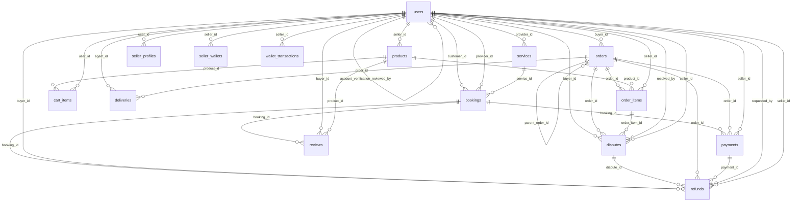

# Database Schema

| Field | Value |
|---|---|
| Audit date | 2026-10-29 |
| Document version | 1.0 |
| Status | **Verified** unless a line says otherwise |
| Method | All 160 files in `database/migrations/` were applied in order with the project's own `database/migrate.js` to an empty **MariaDB 10.11.14** database. Schema facts below were read from `information_schema`, not inferred from SQL text. |
| Not verified | Behaviour on MySQL 8 (the version `docs/DATABASE.md` names); production data volumes, retention, backups |

## 1. Summary

| Metric | Value |
|---|---|
| Application tables | 131 (+ `schema_migrations`, the runner's own tracking table) |
| Columns | 1,392 (all tables) |
| Foreign keys | 209 (`CASCADE` 101, `RESTRICT` 79, `SET NULL` 29) |
| Indexes (incl. primary and unique) | 471 |
| CHECK constraints | 25 (JSON validity, positive quantities, rating range, one-of-two-targets) |
| Tables using `ENUM` columns | 66 |
| Views / triggers / stored routines | 0 views; 0 triggers (checked on the test DB) |

Relationship to other docs: `docs/DATABASE.md` describes migrations 001-082 only and names roughly 52 of 131 tables. This document supersedes it for column-level facts. Full ERD: `docs/diagrams/database-erd.mmd`. Field-level detail: `docs/technical/data-dictionary.md`.

## 2. Domain map

Domain grouping is **Inferred** from table names (the schema has no formal grouping).

| Domain | Tables | Count |
|---|---|---|
| Identity & accounts | `account_verification_documents`, `account_verification_document_flags`, `account_verification_history`, `business_verification_requests`, `buyer_addresses`, `data_reset_approvals`, `kyc_tier_limits`, `kyc_upgrade_requests`, `loyalty_points_ledger`, `otp_codes`, `push_subscriptions`, `referrals`, `users` | 13 |
| Catalog & storefront | `categories`, `content_articles`, `pickup_points`, `products`, `product_alerts`, `product_audio`, `product_bulk_price_tiers`, `product_images`, `product_media`, `product_questions`, `product_variants`, `product_variant_options`, `product_variant_option_values`, `product_videos`, `search_queries`, `search_zero_results`, `seller_collections`, `seller_collection_products`, `seller_profiles`, `seller_saved_filters`, `store_follows`, `store_types`, `wishlist_items` | 23 |
| Services & bookings | `bookings`, `booking_items`, `services`, `service_availability`, `service_categories`, `service_media`, `service_pricing_rules` | 7 |
| Cart, orders & returns | `cart_items`, `coupons`, `coupon_redemptions`, `group_buys`, `group_buy_participants`, `live_selling_reminders`, `live_selling_sessions`, `orders`, `order_items`, `order_returns`, `order_return_history`, `return_evidence` | 12 |
| Payments, wallets & payouts | `agent_earnings`, `buyer_wallets`, `buyer_wallet_transactions`, `efd_receipts`, `payments`, `payment_review_queue`, `refunds`, `seller_wallets`, `wallet_reconciliation_flags`, `wallet_top_ups`, `wallet_transactions`, `webhook_replay_guard`, `withdrawal_requests` | 13 |
| Delivery | `deliveries`, `delivery_businesses`, `delivery_business_agents`, `delivery_business_jobs`, `delivery_eta_adjustments`, `delivery_offers`, `delivery_rate_cards`, `delivery_ratings`, `fuel_reference`, `seller_delivery_agents` | 10 |
| Messaging, support & disputes | `admin_notifications`, `broadcasts`, `conversations`, `disputes`, `dispute_evidence`, `dispute_history`, `dispute_messages`, `email_delivery_events`, `email_outbox`, `messages`, `message_reactions`, `notifications`, `reviews`, `review_photos`, `support_messages`, `support_tickets`, `whatsapp_sessions` | 17 |
| Monetization & growth | `affiliate_accounts`, `affiliate_clicks`, `affiliate_conversions`, `affiliate_payouts`, `monetization_schedule`, `seller_sponsorship_credit_periods`, `seller_subscriptions`, `sponsorship_campaigns`, `store_featured_campaigns`, `subscription_plans` | 10 |
| Seller stock & POS | `offline_sales`, `purchases`, `purchase_lines`, `sales`, `sale_lines`, `sale_returns`, `sale_return_lines`, `stock_adjustments`, `stock_counters`, `stock_customers`, `stock_expenses`, `stock_items`, `stock_low_alert_state`, `stock_movements`, `stock_payments`, `stock_suppliers` | 16 |
| Platform, AI & observability | `ai_call_outcomes`, `ai_usage_log`, `audit_logs`, `fraud_flags`, `platform_modules`, `platform_settings`, `platform_setting_history`, `status_incidents`, `status_subscribers`, `web_vitals_samples` | 10 |

## 3. Most-referenced tables (inbound foreign keys)

| Table | Inbound FKs |
|---|---|
| `users` | 113 |
| `products` | 20 |
| `orders` | 16 |
| `services` | 5 |
| `bookings` | 4 |
| `disputes` | 4 |
| `stock_items` | 4 |
| `categories` | 3 |
| `product_variants` | 3 |
| `order_returns` | 3 |
| `delivery_businesses` | 2 |
| `order_items` | 2 |

## 4. Per-table reference

PK = primary key. FK targets show the delete rule. Unique and secondary indexes follow.

### Identity & accounts

#### `account_verification_documents`

- Columns: 11; PK: `id`
- Foreign keys: `business_request_id` -> `business_verification_requests.id` (CASCADE); `user_id` -> `users.id` (CASCADE)
- Indexes: `idx_account_verification_documents_business_request` (business_request_id); `idx_account_verification_documents_user` (user_id)

#### `account_verification_document_flags`

- Columns: 4; PK: `document_id`
- Foreign keys: `flagged_by` -> `users.id` (SET NULL); `document_id` -> `account_verification_documents.id` (CASCADE)
- Indexes: `fk_avdf_admin` (flagged_by)

#### `account_verification_history`

- Columns: 6; PK: `id`
- Foreign keys: `actor_admin_id` -> `users.id` (SET NULL); `user_id` -> `users.id` (CASCADE)
- Indexes: `fk_account_verification_history_actor` (actor_admin_id); `idx_account_verification_history_user` (user_id)

#### `business_verification_requests`

- Columns: 7; PK: `id`
- Foreign keys: `reviewed_by` -> `users.id` (SET NULL); `user_id` -> `users.id` (CASCADE)
- Indexes: `fk_business_verification_requests_reviewer` (reviewed_by); `idx_business_verification_requests_status` (status,submitted_at); `idx_business_verification_requests_user_status` (user_id,status)

#### `buyer_addresses`

- Columns: 13; PK: `id`
- Foreign keys: `user_id` -> `users.id` (CASCADE)
- Indexes: `idx_buyer_addresses_user` (user_id)

#### `data_reset_approvals`

- Columns: 8; PK: `id`
- Foreign keys: `approved_by` -> `users.id` (RESTRICT); `requested_by` -> `users.id` (RESTRICT)
- Indexes: `fk_data_reset_approvals_approved_by` (approved_by); `idx_data_reset_approvals_requested_by` (requested_by)

#### `kyc_tier_limits`

- Columns: 5; PK: `tier`

#### `kyc_upgrade_requests`

- Columns: 17; PK: `id`
- Foreign keys: `reviewed_by` -> `users.id` (RESTRICT); `user_id` -> `users.id` (RESTRICT)
- Indexes: `fk_kyc_upgrade_requests_reviewed_by` (reviewed_by); `idx_kyc_upgrade_requests_status` (status); `idx_kyc_upgrade_requests_user` (user_id)

#### `loyalty_points_ledger`

- Columns: 8; PK: `id`
- Foreign keys: `order_id` -> `orders.id` (RESTRICT); `user_id` -> `users.id` (RESTRICT)
- Indexes: `fk_loyalty_points_ledger_order` (order_id); `idx_loyalty_points_ledger_user` (user_id)

#### `otp_codes`

- Columns: 9; PK: `id`
- Foreign keys: `user_id` -> `users.id` (CASCADE)
- Indexes: `idx_otp_codes_user_purpose` (user_id,purpose,consumed_at)

#### `push_subscriptions`

- Columns: 6; PK: `id`
- Foreign keys: `user_id` -> `users.id` (CASCADE)
- Indexes: `fk_push_subscriptions_user` (user_id); UNIQUE `unique_endpoint` (endpoint)

#### `referrals`

- Columns: 5; PK: `id`
- Foreign keys: `referred_user_id` -> `users.id` (RESTRICT); `referrer_id` -> `users.id` (RESTRICT)
- Indexes: `fk_referrals_referrer` (referrer_id); UNIQUE `referred_user_id` (referred_user_id)

#### `users`

- Columns: 65; PK: `id`
- Foreign keys: `referred_by_user_id` -> `users.id` (RESTRICT); `suspended_by` -> `users.id` (SET NULL); `account_verification_reviewed_by` -> `users.id` (SET NULL)
- Indexes: UNIQUE `email` (email); `fk_users_referred_by` (referred_by_user_id); `fk_users_suspended_by` (suspended_by); `fk_users_verification_reviewed_by` (account_verification_reviewed_by); `idx_users_deleted_at` (deleted_at); `idx_users_last_active` (role,last_active_at); `idx_users_map_visibility` (role,location_sharing_enabled,location_lat); `idx_users_permanently_deleted_at` (permanently_deleted_at); `idx_users_suspended_at` (suspended_at); `idx_users_trial_ends_at` (trial_ends_at); UNIQUE `phone` (phone); UNIQUE `referral_code` (referral_code); UNIQUE `uq_users_google_sub` (google_sub); UNIQUE `uq_users_username` (username)

### Catalog & storefront

#### `categories`

- Columns: 13; PK: `id`
- Indexes: `idx_categories_maintenance_schedule` (maintenance_scheduled_start,maintenance_scheduled_end); UNIQUE `name` (name); UNIQUE `slug` (slug)

#### `content_articles`

- Columns: 13; PK: `id`
- Foreign keys: `author_id` -> `users.id` (RESTRICT); `category_id` -> `categories.id` (SET NULL)
- Indexes: `fk_content_articles_author` (author_id); `fk_content_articles_category` (category_id); `idx_content_articles_status` (status,published_at); UNIQUE `slug` (slug)

#### `pickup_points`

- Columns: 12; PK: `id`
- Indexes: `idx_pickup_points_active` (is_active); `idx_pickup_points_region` (region,city)

#### `products`

- Columns: 21; PK: `id`
- Foreign keys: `category_id` -> `categories.id` (SET NULL); `seller_id` -> `users.id` (RESTRICT)
- Indexes: `fk_products_seller` (seller_id); `ft_products_search` (name,brand,description); `idx_products_active_created` (is_active,created_at); `idx_products_active_price` (is_active,price); `idx_products_category_active` (category_id,is_active); UNIQUE `slug` (slug)

#### `product_alerts`

- Columns: 7; PK: `id`
- Foreign keys: `product_id` -> `products.id` (CASCADE); `user_id` -> `users.id` (CASCADE)
- Indexes: `idx_product_alerts_product_type` (product_id,alert_type,notified_at); UNIQUE `uq_product_alerts_user_product_type` (user_id,product_id,alert_type)

#### `product_audio`

- Columns: 5; PK: `id`
- Foreign keys: `product_id` -> `products.id` (CASCADE)
- Indexes: `fk_product_audio_product` (product_id)

#### `product_bulk_price_tiers`

- Columns: 5; PK: `id`
- Foreign keys: `product_id` -> `products.id` (CASCADE)
- Indexes: UNIQUE `uq_product_bulk_tier_qty` (product_id,min_quantity)

#### `product_images`

- Columns: 6; PK: `id`
- Foreign keys: `product_id` -> `products.id` (CASCADE)
- Indexes: `fk_product_images_product` (product_id)

#### `product_media`

- Columns: 15; PK: `id`
- Foreign keys: `product_id` -> `products.id` (CASCADE)
- Indexes: `idx_product_media_order` (product_id,position); UNIQUE `uq_product_media_legacy` (product_id,kind,legacy_id)
- Checks: `edits`: `json_valid(`edits`)`

#### `product_questions`

- Columns: 7; PK: `id`
- Foreign keys: `product_id` -> `products.id` (CASCADE); `user_id` -> `users.id` (CASCADE)
- Indexes: `fk_product_questions_user` (user_id); `idx_product_questions_product` (product_id,created_at)

#### `product_variants`

- Columns: 11; PK: `id`
- Foreign keys: `product_id` -> `products.id` (CASCADE)
- Indexes: UNIQUE `uq_pv_product_combo` (product_id,options_key)
- Checks: `options`: `json_valid(`options`)`

#### `product_variant_options`

- Columns: 4; PK: `id`
- Foreign keys: `product_id` -> `products.id` (CASCADE)
- Indexes: `idx_pvo_product` (product_id)

#### `product_variant_option_values`

- Columns: 4; PK: `id`
- Foreign keys: `option_id` -> `product_variant_options.id` (CASCADE)
- Indexes: `idx_pvov_option` (option_id)

#### `product_videos`

- Columns: 5; PK: `id`
- Foreign keys: `product_id` -> `products.id` (CASCADE)
- Indexes: `fk_product_videos_product` (product_id)

#### `search_queries`

- Columns: 4; PK: `id`
- Indexes: `idx_search_queries_trending` (normalized_term,created_at)

#### `search_zero_results`

- Columns: 6; PK: `id`
- Indexes: `idx_search_zero_results_hits` (hits); UNIQUE `uq_search_zero_results_term` (scope,term)

#### `seller_collections`

- Columns: 5; PK: `id`
- Foreign keys: `seller_id` -> `users.id` (CASCADE)
- Indexes: `fk_seller_collections_seller` (seller_id)

#### `seller_collection_products`

- Columns: 5; PK: `id`
- Foreign keys: `collection_id` -> `seller_collections.id` (CASCADE); `product_id` -> `products.id` (CASCADE)
- Indexes: `fk_seller_collection_products_product` (product_id); UNIQUE `unique_collection_product` (collection_id,product_id)

#### `seller_profiles`

- Columns: 43; PK: `id`
- Foreign keys: `store_type_id` -> `store_types.id` (RESTRICT); `user_id` -> `users.id` (CASCADE)
- Indexes: `fk_seller_profiles_store_type` (store_type_id); `idx_seller_profiles_region` (region); UNIQUE `store_slug` (store_slug); UNIQUE `user_id` (user_id)
- Checks: `opening_hours`: `json_valid(`opening_hours`)`

#### `seller_saved_filters`

- Columns: 6; PK: `id`
- Foreign keys: `seller_id` -> `users.id` (CASCADE)
- Indexes: `idx_seller_saved_filters_seller_page` (seller_id,page_key)
- Checks: `filters`: `json_valid(`filters`)`

#### `store_follows`

- Columns: 4; PK: `id`
- Foreign keys: `follower_id` -> `users.id` (CASCADE); `store_user_id` -> `users.id` (CASCADE)
- Indexes: `idx_store_follows_store` (store_user_id); UNIQUE `uq_store_follows_pair` (follower_id,store_user_id)

#### `store_types`

- Columns: 5; PK: `id`
- Indexes: UNIQUE `slug` (slug)

#### `wishlist_items`

- Columns: 6; PK: `id`
- Foreign keys: `product_id` -> `products.id` (CASCADE); `service_id` -> `services.id` (CASCADE); `user_id` -> `users.id` (CASCADE)
- Indexes: `fk_wishlist_product` (product_id); `fk_wishlist_service` (service_id); UNIQUE `uq_wishlist_user_product` (user_id,product_id); UNIQUE `uq_wishlist_user_service` (user_id,service_id)
- Checks: `chk_wishlist_one_target`: ``product_id` is not null and `service_id` is null or `product_id` is null and `service_id` is not null`

### Services & bookings

#### `bookings`

- Columns: 14; PK: `id`
- Foreign keys: `customer_id` -> `users.id` (RESTRICT); `provider_id` -> `users.id` (RESTRICT); `service_id` -> `services.id` (RESTRICT)
- Indexes: UNIQUE `booking_reference` (booking_reference); `idx_bookings_customer` (customer_id); `idx_bookings_is_test` (is_test); `idx_bookings_provider_status` (provider_id,status); `idx_bookings_service_dates` (service_id,start_date,end_date)

#### `booking_items`

- Columns: 12; PK: `id`
- Foreign keys: `booking_id` -> `bookings.id` (CASCADE)
- Indexes: `idx_booking_items_escrow_release` (wallet_credited,wallet_released); UNIQUE `uq_booking_items_date` (booking_id,service_date)

#### `services`

- Columns: 21; PK: `id`
- Foreign keys: `category_id` -> `service_categories.id` (SET NULL); `provider_id` -> `users.id` (CASCADE)
- Indexes: `ft_services_search` (title,description); `idx_services_category_status` (category_id,status); `idx_services_city` (city); `idx_services_provider` (provider_id); UNIQUE `slug` (slug)

#### `service_availability`

- Columns: 8; PK: `id`
- Foreign keys: `service_id` -> `services.id` (CASCADE)
- Indexes: `idx_service_availability_date` (date); UNIQUE `uq_service_availability_date` (service_id,date)

#### `service_categories`

- Columns: 11; PK: `id`
- Indexes: UNIQUE `name` (name); UNIQUE `slug` (slug)

#### `service_media`

- Columns: 7; PK: `id`
- Foreign keys: `service_id` -> `services.id` (CASCADE)
- Indexes: `idx_service_media_service` (service_id)

#### `service_pricing_rules`

- Columns: 12; PK: `id`
- Foreign keys: `service_id` -> `services.id` (CASCADE)
- Indexes: `idx_pricing_rules_service` (service_id,is_active)
- Checks: `chk_pricing_rule_day_of_week`: ``rule_type` = 'day_of_week' and `day_of_week` between 0 and 6 and `start_date` is null and `end_date` is null or `rule_type` = 'date_range' and `day_of_week` is null and `start_date` is not null and `end_date` is not null and `end_date` >= `start_date``

### Cart, orders & returns

#### `cart_items`

- Columns: 7; PK: `id`
- Foreign keys: `product_id` -> `products.id` (CASCADE); `user_id` -> `users.id` (CASCADE)
- Indexes: `fk_cart_items_product` (product_id); UNIQUE `unique_user_product_variant` (user_id,product_id,variant_id)

#### `coupons`

- Columns: 13; PK: `id`
- Indexes: UNIQUE `uq_coupons_code` (code)

#### `coupon_redemptions`

- Columns: 6; PK: `id`
- Foreign keys: `coupon_id` -> `coupons.id` (CASCADE); `user_id` -> `users.id` (CASCADE)
- Indexes: `fk_coupon_redemptions_user` (user_id); `idx_coupon_redemptions_coupon_user` (coupon_id,user_id); UNIQUE `uq_coupon_redemptions_user` (coupon_id,user_id)

#### `group_buys`

- Columns: 9; PK: `id`
- Foreign keys: `product_id` -> `products.id` (RESTRICT); `seller_id` -> `users.id` (RESTRICT)
- Indexes: `fk_group_buys_product` (product_id); `fk_group_buys_seller` (seller_id); `idx_group_buys_status_deadline` (status,deadline)

#### `group_buy_participants`

- Columns: 6; PK: `id`
- Foreign keys: `buyer_id` -> `users.id` (RESTRICT); `group_buy_id` -> `group_buys.id` (CASCADE); `order_id` -> `orders.id` (RESTRICT)
- Indexes: `fk_group_buy_participants_buyer` (buyer_id); `fk_group_buy_participants_order` (order_id); UNIQUE `uq_group_buy_participant` (group_buy_id,buyer_id)

#### `live_selling_reminders`

- Columns: 5; PK: `id`
- Foreign keys: `session_id` -> `live_selling_sessions.id` (CASCADE); `user_id` -> `users.id` (CASCADE)
- Indexes: `idx_live_selling_reminders_session` (session_id,notified_at); UNIQUE `uq_live_selling_reminders_pair` (user_id,session_id)

#### `live_selling_sessions`

- Columns: 9; PK: `id`
- Foreign keys: `seller_id` -> `users.id` (RESTRICT)
- Indexes: `fk_live_selling_sessions_seller` (seller_id); `idx_live_selling_sessions_status_time` (status,scheduled_at)

#### `orders`

- Columns: 50; PK: `id`
- Foreign keys: `buyer_id` -> `users.id` (RESTRICT); `parent_order_id` -> `orders.id` (CASCADE); `pickup_point_id` -> `pickup_points.id` (RESTRICT)
- Indexes: `fk_orders_pickup_point` (pickup_point_id); `idx_orders_buyer_created` (buyer_id,created_at); `idx_orders_is_test` (is_test); `idx_orders_parent_order_id` (parent_order_id); UNIQUE `order_number` (order_number)
- Checks: `rider_fee_quote_details`: `json_valid(`rider_fee_quote_details`)`

#### `order_items`

- Columns: 17; PK: `id`
- Foreign keys: `order_id` -> `orders.id` (CASCADE); `product_id` -> `products.id` (RESTRICT); `seller_id` -> `users.id` (RESTRICT)
- Indexes: `fk_order_items_order` (order_id); `fk_order_items_product` (product_id); `fk_order_items_seller` (seller_id); `idx_order_items_escrow_release` (wallet_credited,wallet_released)

#### `order_returns`

- Columns: 20; PK: `id`
- Foreign keys: `buyer_id` -> `users.id` (RESTRICT); `decided_by` -> `users.id` (RESTRICT); `order_item_id` -> `order_items.id` (RESTRICT); `order_id` -> `orders.id` (RESTRICT); `seller_id` -> `users.id` (RESTRICT)
- Indexes: `fk_order_returns_decided_by` (decided_by); `fk_order_returns_item` (order_item_id); `idx_order_returns_buyer` (buyer_id); `idx_order_returns_is_test` (is_test); `idx_order_returns_order` (order_id); `idx_order_returns_seller` (seller_id); `idx_order_returns_status` (status)

#### `order_return_history`

- Columns: 6; PK: `id`
- Foreign keys: `actor_id` -> `users.id` (RESTRICT); `return_id` -> `order_returns.id` (CASCADE)
- Indexes: `fk_order_return_history_actor` (actor_id); `idx_order_return_history_return` (return_id)

#### `return_evidence`

- Columns: 5; PK: `id`
- Foreign keys: `return_id` -> `order_returns.id` (CASCADE); `uploaded_by` -> `users.id` (RESTRICT)
- Indexes: `fk_return_evidence_user` (uploaded_by); `idx_return_evidence_return` (return_id)

### Payments, wallets & payouts

#### `agent_earnings`

- Columns: 8; PK: `id`
- Foreign keys: `agent_id` -> `users.id` (CASCADE); `delivery_id` -> `deliveries.id` (CASCADE); `order_id` -> `orders.id` (CASCADE)
- Indexes: UNIQUE `delivery_id` (delivery_id); `fk_agent_earnings_agent` (agent_id); `fk_agent_earnings_order` (order_id); `idx_agent_earnings_release` (status,created_at)

#### `buyer_wallets`

- Columns: 4; PK: `buyer_id`
- Foreign keys: `buyer_id` -> `users.id` (CASCADE)

#### `buyer_wallet_transactions`

- Columns: 12; PK: `id`
- Foreign keys: `buyer_id` -> `users.id` (CASCADE)
- Indexes: `fk_buyer_wallet_transactions_buyer` (buyer_id); `idx_buyer_wallet_transactions_is_test` (is_test); UNIQUE `uniq_buyer_wallet_dedupe` (dedupe_key)

#### `efd_receipts`

- Columns: 15; PK: `id`
- Foreign keys: `order_id` -> `orders.id` (CASCADE); `seller_id` -> `users.id` (RESTRICT)
- Indexes: `idx_efd_receipts_seller` (seller_id); `idx_efd_receipts_status` (status); UNIQUE `order_id` (order_id)
- Checks: `raw_response`: `json_valid(`raw_response`)`

#### `payments`

- Columns: 24; PK: `id`
- Foreign keys: `booking_id` -> `bookings.id` (CASCADE); `order_id` -> `orders.id` (CASCADE); `seller_id` -> `users.id` (CASCADE); `subscription_id` -> `seller_subscriptions.id` (CASCADE); `topup_id` -> `wallet_top_ups.id` (CASCADE)
- Indexes: `fk_payments_order` (order_id); `idx_payments_booking` (booking_id); `idx_payments_seller_purpose` (seller_id,purpose,status); `idx_payments_status_created` (status,created_at); `idx_payments_subscription` (subscription_id); `idx_payments_topup` (topup_id); UNIQUE `receipt_number` (receipt_number); UNIQUE `uniq_payments_reference` (payment_reference)

#### `payment_review_queue`

- Columns: 9; PK: `id`
- Foreign keys: `payment_id` -> `payments.id` (CASCADE)
- Indexes: `idx_payment_review_status` (status,created_at); UNIQUE `uniq_payment_review` (payment_id,reason)

#### `refunds`

- Columns: 19; PK: `id`
- Foreign keys: `booking_id` -> `bookings.id` (CASCADE); `buyer_id` -> `users.id` (RESTRICT); `dispute_id` -> `disputes.id` (CASCADE); `order_id` -> `orders.id` (RESTRICT); `payment_id` -> `payments.id` (RESTRICT); `requested_by` -> `users.id` (RESTRICT); `return_id` -> `order_returns.id` (CASCADE); `seller_id` -> `users.id` (RESTRICT)
- Indexes: UNIQUE `booking_id` (booking_id); UNIQUE `dispute_id` (dispute_id); `fk_refunds_payment` (payment_id); `fk_refunds_requested_by` (requested_by); `fk_refunds_seller` (seller_id); UNIQUE `idempotency_key` (idempotency_key); `idx_refunds_buyer` (buyer_id); `idx_refunds_order` (order_id); `idx_refunds_status` (status); UNIQUE `return_id` (return_id)
- Checks: `chk_refunds_one_source_v2`: ``dispute_id` is not null and `return_id` is null and `booking_id` is null or `dispute_id` is null and `return_id` is not null and `booking_id` is null or `dispute_id` is null and `return_id` is null and `booking_id` is not null or `dispute_id` is null and `return_id` is null and `booking_id` is null`

#### `seller_wallets`

- Columns: 4; PK: `seller_id`
- Foreign keys: `seller_id` -> `users.id` (CASCADE)
- Indexes: `idx_seller_wallets_negative` (balance)

#### `wallet_reconciliation_flags`

- Columns: 9; PK: `id`
- Indexes: `idx_wallet_reconciliation_status` (status,created_at)

#### `wallet_top_ups`

- Columns: 6; PK: `id`
- Foreign keys: `buyer_id` -> `users.id` (CASCADE)
- Indexes: `fk_wallet_top_ups_buyer` (buyer_id)

#### `wallet_transactions`

- Columns: 10; PK: `id`
- Foreign keys: `seller_id` -> `users.id` (CASCADE)
- Indexes: `fk_wallet_transactions_seller` (seller_id); `idx_wallet_transactions_is_test` (is_test)

#### `webhook_replay_guard`

- Columns: 4; PK: `id`
- Indexes: `idx_received_at` (received_at); UNIQUE `uniq_provider_payload_hash` (provider,payload_hash)

#### `withdrawal_requests`

- Columns: 20; PK: `id`
- Foreign keys: `seller_id` -> `users.id` (CASCADE)
- Indexes: `idx_withdrawal_seller_method_details` (seller_id,payout_method,payout_details)

### Delivery

#### `deliveries`

- Columns: 22; PK: `id`
- Foreign keys: `agent_id` -> `users.id` (RESTRICT); `order_id` -> `orders.id` (CASCADE)
- Indexes: `fk_deliveries_agent` (agent_id); UNIQUE `order_id` (order_id)

#### `delivery_businesses`

- Columns: 4; PK: `id`
- Foreign keys: `owner_user_id` -> `users.id` (CASCADE)
- Indexes: UNIQUE `uq_delivery_businesses_owner` (owner_user_id)

#### `delivery_business_agents`

- Columns: 4; PK: `id`
- Foreign keys: `agent_id` -> `users.id` (CASCADE); `business_id` -> `delivery_businesses.id` (CASCADE)
- Indexes: `idx_dba_business` (business_id); UNIQUE `uq_dba_agent` (agent_id)

#### `delivery_business_jobs`

- Columns: 19; PK: `id`
- Foreign keys: `assigned_agent_id` -> `users.id` (SET NULL); `business_id` -> `delivery_businesses.id` (CASCADE)
- Indexes: `idx_dbj_agent` (assigned_agent_id,status); `idx_dbj_business_status` (business_id,status,created_at)
- Checks: `chk_dbj_fee`: ``fee_amount` >= 0`

#### `delivery_eta_adjustments`

- Columns: 10; PK: `id`
- Indexes: `idx_eta_adjustments_region` (region,is_active)

#### `delivery_offers`

- Columns: 15; PK: `id`
- Foreign keys: `agent_id` -> `users.id` (CASCADE); `order_id` -> `orders.id` (CASCADE)
- Indexes: `fk_delivery_offers_agent` (agent_id); UNIQUE `unique_order_agent` (order_id,agent_id)

#### `delivery_rate_cards`

- Columns: 8; PK: `id`
- Foreign keys: `created_by` -> `users.id` (SET NULL)
- Indexes: `fk_rate_cards_created_by` (created_by); `idx_rate_cards_vehicle_effective` (vehicle_type,effective_from)

#### `delivery_ratings`

- Columns: 8; PK: `id`
- Foreign keys: `agent_id` -> `users.id` (CASCADE); `buyer_id` -> `users.id` (RESTRICT); `order_id` -> `orders.id` (CASCADE)
- Indexes: `fk_delivery_ratings_buyer` (buyer_id); `idx_delivery_ratings_agent` (agent_id); UNIQUE `order_id` (order_id)
- Checks: `chk_delivery_ratings_rating`: ``rating` between 1 and 5`

#### `fuel_reference`

- Columns: 7; PK: `id`
- Foreign keys: `entered_by` -> `users.id` (SET NULL)
- Indexes: `fk_fuel_reference_entered_by` (entered_by); `idx_fuel_reference_lookup` (region,product,effective_from)

#### `seller_delivery_agents`

- Columns: 4; PK: `id`
- Foreign keys: `agent_id` -> `users.id` (CASCADE); `seller_id` -> `users.id` (CASCADE)
- Indexes: `fk_seller_delivery_agents_agent` (agent_id); UNIQUE `unique_seller_agent` (seller_id,agent_id)

### Messaging, support & disputes

#### `admin_notifications`

- Columns: 12; PK: `id`
- Foreign keys: `related_user_id` -> `users.id` (SET NULL); `read_by` -> `users.id` (SET NULL)
- Indexes: `idx_admin_notifications_category` (category); `idx_admin_notifications_created_at` (created_at); `idx_admin_notifications_is_read` (is_read); `idx_admin_notifications_type` (type); `read_by` (read_by); `related_user_id` (related_user_id)
- Checks: `metadata`: `json_valid(`metadata`)`

#### `broadcasts`

- Columns: 18; PK: `id`
- Foreign keys: `admin_id` -> `users.id` (RESTRICT)
- Indexes: `admin_id` (admin_id); `idx_broadcasts_created_at` (created_at); `idx_broadcasts_deleted_at` (deleted_at); `idx_broadcasts_template_type` (template_type)

#### `conversations`

- Columns: 21; PK: `id`
- Foreign keys: `buyer_id` -> `users.id` (RESTRICT); `delivery_agent_id` -> `users.id` (RESTRICT); `order_id` -> `orders.id` (SET NULL); `product_id` -> `products.id` (SET NULL); `seller_id` -> `users.id` (RESTRICT)
- Indexes: `fk_conversations_buyer` (buyer_id); `fk_conversations_delivery_agent` (delivery_agent_id); `fk_conversations_order` (order_id); `fk_conversations_product` (product_id); `fk_conversations_seller` (seller_id); `idx_conversations_is_test` (is_test)

#### `disputes`

- Columns: 22; PK: `id`
- Foreign keys: `buyer_id` -> `users.id` (RESTRICT); `order_id` -> `orders.id` (CASCADE); `order_item_id` -> `order_items.id` (SET NULL); `resolved_by` -> `users.id` (RESTRICT); `seller_id` -> `users.id` (RESTRICT)
- Indexes: UNIQUE `dispute_number` (dispute_number); `fk_disputes_order_item` (order_item_id); `fk_disputes_resolved_by` (resolved_by); `idx_disputes_buyer` (buyer_id); `idx_disputes_is_test` (is_test); `idx_disputes_order` (order_id); `idx_disputes_seller` (seller_id); `idx_disputes_status` (status); `idx_disputes_status_created` (status,created_at)

#### `dispute_evidence`

- Columns: 5; PK: `id`
- Foreign keys: `dispute_id` -> `disputes.id` (CASCADE); `uploaded_by` -> `users.id` (RESTRICT)
- Indexes: `fk_dispute_evidence_dispute` (dispute_id); `fk_dispute_evidence_user` (uploaded_by)

#### `dispute_history`

- Columns: 6; PK: `id`
- Foreign keys: `actor_id` -> `users.id` (RESTRICT); `dispute_id` -> `disputes.id` (CASCADE)
- Indexes: `fk_dispute_history_actor` (actor_id); `fk_dispute_history_dispute` (dispute_id)

#### `dispute_messages`

- Columns: 6; PK: `id`
- Foreign keys: `dispute_id` -> `disputes.id` (CASCADE); `sender_id` -> `users.id` (RESTRICT)
- Indexes: `fk_dispute_messages_dispute` (dispute_id); `fk_dispute_messages_sender` (sender_id)

#### `email_delivery_events`

- Columns: 7; PK: `id`
- Indexes: `idx_email_delivery_events_broadcast` (broadcast_id,event_type); `idx_email_delivery_events_email` (recipient_email); `idx_email_delivery_events_type` (event_type)
- Checks: `raw_event`: `json_valid(`raw_event`)`

#### `email_outbox`

- Columns: 11; PK: `id`
- Indexes: `idx_email_outbox_due` (status,next_attempt_at)

#### `messages`

- Columns: 14; PK: `id`
- Foreign keys: `conversation_id` -> `conversations.id` (CASCADE); `sender_id` -> `users.id` (RESTRICT)
- Indexes: `fk_messages_sender` (sender_id); `idx_messages_conversation_created` (conversation_id,created_at)

#### `message_reactions`

- Columns: 5; PK: `id`
- Foreign keys: `message_id` -> `messages.id` (CASCADE); `user_id` -> `users.id` (CASCADE)
- Indexes: `fk_message_reactions_user` (user_id); `idx_message_reactions_message` (message_id); UNIQUE `uq_message_reaction` (message_id,user_id,emoji)

#### `notifications`

- Columns: 9; PK: `id`
- Foreign keys: `related_conversation_id` -> `conversations.id` (SET NULL); `related_order_id` -> `orders.id` (SET NULL); `user_id` -> `users.id` (CASCADE)
- Indexes: `fk_notifications_order` (related_order_id); `fk_notifications_user` (user_id); `idx_notifications_conversation` (related_conversation_id)

#### `reviews`

- Columns: 11; PK: `id`
- Foreign keys: `booking_id` -> `bookings.id` (CASCADE); `buyer_id` -> `users.id` (RESTRICT); `product_id` -> `products.id` (CASCADE)
- Indexes: `fk_reviews_product` (product_id); `idx_reviews_booking` (booking_id); `idx_reviews_is_test` (is_test); UNIQUE `unique_buyer_booking` (buyer_id,booking_id); UNIQUE `unique_buyer_product` (buyer_id,product_id)
- Checks: `chk_reviews_rating`: ``rating` between 1 and 5`; `chk_reviews_target`: ``product_id` is not null and `booking_id` is null or `product_id` is null and `booking_id` is not null`

#### `review_photos`

- Columns: 5; PK: `id`
- Foreign keys: `review_id` -> `reviews.id` (CASCADE)
- Indexes: `fk_review_photos_review` (review_id)

#### `support_messages`

- Columns: 7; PK: `id`
- Foreign keys: `sender_id` -> `users.id` (RESTRICT); `ticket_id` -> `support_tickets.id` (CASCADE)
- Indexes: `fk_support_messages_sender` (sender_id); `idx_support_messages_ticket` (ticket_id)

#### `support_tickets`

- Columns: 8; PK: `id`
- Foreign keys: `user_id` -> `users.id` (RESTRICT)
- Indexes: `idx_support_tickets_status` (status); `idx_support_tickets_user` (user_id)

#### `whatsapp_sessions`

- Columns: 4; PK: `phone`
- Checks: `context`: `json_valid(`context`)`

### Monetization & growth

#### `affiliate_accounts`

- Columns: 5; PK: `user_id`
- Foreign keys: `user_id` -> `users.id` (RESTRICT)
- Indexes: UNIQUE `code` (code)

#### `affiliate_clicks`

- Columns: 5; PK: `id`
- Foreign keys: `affiliate_user_id` -> `users.id` (RESTRICT)
- Indexes: UNIQUE `click_token` (click_token); `fk_affiliate_clicks_affiliate` (affiliate_user_id)

#### `affiliate_conversions`

- Columns: 8; PK: `id`
- Foreign keys: `affiliate_user_id` -> `users.id` (RESTRICT); `order_id` -> `orders.id` (RESTRICT)
- Indexes: `fk_affiliate_conversions_affiliate` (affiliate_user_id); UNIQUE `order_id` (order_id)

#### `affiliate_payouts`

- Columns: 10; PK: `id`
- Foreign keys: `affiliate_user_id` -> `users.id` (CASCADE)
- Indexes: `idx_affiliate_payouts_status` (status,requested_at); `idx_affiliate_payouts_user_status` (affiliate_user_id,status)

#### `monetization_schedule`

- Columns: 10; PK: `id`
- Foreign keys: `created_by` -> `users.id` (SET NULL)
- Indexes: `created_by` (created_by); `idx_monetization_schedule_pending` (scheduled_at,applied_at,cancelled_at)

#### `seller_sponsorship_credit_periods`

- Columns: 9; PK: `id`
- Foreign keys: `seller_id` -> `users.id` (CASCADE); `subscription_id` -> `seller_subscriptions.id` (CASCADE)
- Indexes: `idx_credit_periods_seller_period` (seller_id,period_end); UNIQUE `uq_credit_periods_subscription` (subscription_id)

#### `seller_subscriptions`

- Columns: 12; PK: `id`
- Foreign keys: `plan_id` -> `subscription_plans.id` (RESTRICT); `seller_id` -> `users.id` (CASCADE)
- Indexes: `fk_seller_subscriptions_plan` (plan_id); `idx_seller_subscriptions_lifecycle` (status,current_period_end); `idx_seller_subscriptions_seller_status` (seller_id,status)

#### `sponsorship_campaigns`

- Columns: 14; PK: `id`
- Foreign keys: `product_id` -> `products.id` (CASCADE); `seller_id` -> `users.id` (CASCADE)
- Indexes: `idx_sponsorship_campaigns_product` (product_id); `idx_sponsorship_campaigns_seller` (seller_id); `idx_sponsorship_campaigns_status_ends` (status,ends_at)

#### `store_featured_campaigns`

- Columns: 11; PK: `id`
- Foreign keys: `category_id` -> `categories.id` (CASCADE); `seller_id` -> `users.id` (CASCADE)
- Indexes: `idx_store_featured_campaigns_category_status_ends` (category_id,status,ends_at); `idx_store_featured_campaigns_seller` (seller_id); `idx_store_featured_campaigns_status_ends` (status,ends_at)

#### `subscription_plans`

- Columns: 16; PK: `id`
- Indexes: UNIQUE `code` (code)
- Checks: `features`: `json_valid(`features`)`; `entitlements`: `json_valid(`entitlements`)`

### Seller stock & POS

#### `offline_sales`

- Columns: 14; PK: `id`
- Foreign keys: `product_id` -> `products.id` (RESTRICT); `seller_id` -> `users.id` (RESTRICT); `variant_id` -> `product_variants.id` (RESTRICT)
- Indexes: `fk_offline_sales_variant` (variant_id); `idx_offline_sales_product` (product_id); `idx_offline_sales_seller_sold` (seller_id,sold_at)
- Checks: `chk_offline_sales_quantity`: ``quantity` > 0`

#### `purchases`

- Columns: 16; PK: `id`
- Foreign keys: `seller_id` -> `users.id` (RESTRICT); `supplier_id` -> `stock_suppliers.id` (SET NULL)
- Indexes: `fk_purchases_supplier` (supplier_id); `idx_purchases_seller_date` (seller_id,purchased_at); `idx_purchases_supplier` (seller_id,supplier_id); UNIQUE `uq_purchases_idem` (seller_id,idempotency_key); UNIQUE `uq_purchases_no` (seller_id,purchase_no)

#### `purchase_lines`

- Columns: 8; PK: `id`
- Foreign keys: `stock_item_id` -> `stock_items.id` (RESTRICT); `purchase_id` -> `purchases.id` (CASCADE)
- Indexes: `idx_purchase_lines_item` (stock_item_id); `idx_purchase_lines_purchase` (purchase_id)
- Checks: `chk_purchase_lines_quantity`: ``quantity` > 0`

#### `sales`

- Columns: 27; PK: `id`
- Foreign keys: `customer_id` -> `stock_customers.id` (SET NULL); `seller_id` -> `users.id` (RESTRICT)
- Indexes: `fk_sales_customer` (customer_id); `idx_sales_customer` (seller_id,customer_id,voided_at); `idx_sales_report` (seller_id,sold_at,voided_at); `idx_sales_seller_sold` (seller_id,sold_at); UNIQUE `uq_sales_idem` (seller_id,idempotency_key); UNIQUE `uq_sales_legacy` (legacy_offline_sale_id); UNIQUE `uq_sales_receipt` (seller_id,receipt_no)

#### `sale_lines`

- Columns: 12; PK: `id`
- Foreign keys: `stock_item_id` -> `stock_items.id` (SET NULL); `sale_id` -> `sales.id` (CASCADE)
- Indexes: `idx_sale_lines_item` (stock_item_id); `idx_sale_lines_sale` (sale_id); `idx_sale_lines_seller` (seller_id)
- Checks: `chk_sale_lines_quantity`: ``quantity` > 0`

#### `sale_returns`

- Columns: 11; PK: `id`
- Foreign keys: `sale_id` -> `sales.id` (RESTRICT); `seller_id` -> `users.id` (RESTRICT)
- Indexes: `idx_sale_returns_sale` (sale_id); UNIQUE `uq_sale_returns_idem` (seller_id,idempotency_key)

#### `sale_return_lines`

- Columns: 5; PK: `id`
- Foreign keys: `sale_line_id` -> `sale_lines.id` (RESTRICT); `return_id` -> `sale_returns.id` (CASCADE)
- Indexes: `fk_sale_return_lines_line` (sale_line_id); `idx_sale_return_lines_return` (return_id)
- Checks: `chk_sale_return_lines_quantity`: ``quantity` > 0`

#### `stock_adjustments`

- Columns: 13; PK: `id`
- Foreign keys: `product_id` -> `products.id` (RESTRICT); `offline_sale_id` -> `offline_sales.id` (RESTRICT); `seller_id` -> `users.id` (RESTRICT); `variant_id` -> `product_variants.id` (RESTRICT)
- Indexes: `fk_stock_adjustments_sale` (offline_sale_id); `fk_stock_adjustments_variant` (variant_id); `idx_stock_adjustments_product` (product_id,created_at); `idx_stock_adjustments_seller_created` (seller_id,created_at); UNIQUE `uq_stock_adjustments_idem` (seller_id,idempotency_key)
- Checks: `chk_stock_adjustments_after`: ``stock_after` >= 0`

#### `stock_counters`

- Columns: 3; PK: `seller_id, kind`
- Foreign keys: `seller_id` -> `users.id` (RESTRICT)

#### `stock_customers`

- Columns: 8; PK: `id`
- Foreign keys: `seller_id` -> `users.id` (RESTRICT)
- Indexes: `idx_stock_customers_seller` (seller_id,is_archived,name); UNIQUE `uq_stock_customers_phone` (seller_id,phone)

#### `stock_expenses`

- Columns: 15; PK: `id`
- Foreign keys: `seller_id` -> `users.id` (RESTRICT)
- Indexes: `idx_stock_expenses_category` (seller_id,category,expense_date); `idx_stock_expenses_date` (seller_id,expense_date); UNIQUE `uq_stock_expenses_idem` (seller_id,idempotency_key)

#### `stock_items`

- Columns: 18; PK: `id`
- Foreign keys: `product_id` -> `products.id` (SET NULL); `seller_id` -> `users.id` (RESTRICT); `variant_id` -> `product_variants.id` (SET NULL)
- Indexes: `fk_stock_items_variant` (variant_id); `idx_stock_items_product` (product_id); `idx_stock_items_seller` (seller_id,is_archived,name); `idx_stock_items_sku` (seller_id,sku); UNIQUE `uq_stock_items_barcode` (seller_id,barcode); UNIQUE `uq_stock_items_legacy` (legacy_product_id); UNIQUE `uq_stock_items_link` (link_key)

#### `stock_low_alert_state`

- Columns: 4; PK: `stock_item_id`
- Foreign keys: `stock_item_id` -> `stock_items.id` (CASCADE)
- Indexes: `idx_stock_low_alert_seller` (seller_id)

#### `stock_movements`

- Columns: 15; PK: `id`
- Foreign keys: `stock_item_id` -> `stock_items.id` (RESTRICT); `seller_id` -> `users.id` (RESTRICT)
- Indexes: `idx_stock_movements_item` (stock_item_id,created_at); `idx_stock_movements_ref` (ref_type,ref_id); `idx_stock_movements_seller` (seller_id,created_at); UNIQUE `uq_stock_movements_idem` (seller_id,idempotency_key)

#### `stock_payments`

- Columns: 16; PK: `id`
- Foreign keys: `seller_id` -> `users.id` (RESTRICT)
- Indexes: `idx_stock_payments_batch` (seller_id,batch_key); `idx_stock_payments_customer` (seller_id,customer_id); `idx_stock_payments_purchase` (purchase_id); `idx_stock_payments_sale` (sale_id); `idx_stock_payments_seller_date` (seller_id,paid_at)
- Checks: `chk_stock_payments_amount`: ``amount` > 0`

#### `stock_suppliers`

- Columns: 8; PK: `id`
- Foreign keys: `seller_id` -> `users.id` (RESTRICT)
- Indexes: `idx_stock_suppliers_seller` (seller_id,is_archived,name); UNIQUE `uq_stock_suppliers_phone` (seller_id,phone)

### Platform, AI & observability

#### `ai_call_outcomes`

- Columns: 4; PK: `id`
- Indexes: `idx_ai_call_outcomes_feature_created` (feature,created_at)

#### `ai_usage_log`

- Columns: 5; PK: `id`
- Foreign keys: `user_id` -> `users.id` (CASCADE)
- Indexes: `idx_ai_usage_log_created` (created_at); `idx_ai_usage_log_user_created` (user_id,created_at)

#### `audit_logs`

- Columns: 7; PK: `id`
- Foreign keys: `user_id` -> `users.id` (SET NULL)
- Indexes: `idx_audit_logs_created_at` (created_at); `idx_audit_logs_event_type` (event_type); `idx_audit_logs_user_id` (user_id)
- Checks: `metadata`: `json_valid(`metadata`)`

#### `fraud_flags`

- Columns: 10; PK: `id`
- Foreign keys: `resolved_by` -> `users.id` (SET NULL)
- Indexes: `fk_fraud_flags_resolved_by` (resolved_by); `idx_fraud_flags_entity` (entity_type,entity_id); `idx_fraud_flags_status` (status,created_at)

#### `platform_modules`

- Columns: 9; PK: `id`
- Foreign keys: `updated_by` -> `users.id` (SET NULL)
- Indexes: `fk_platform_modules_updated_by` (updated_by); UNIQUE `module_key` (module_key)

#### `platform_settings`

- Columns: 3; PK: `setting_key`

#### `platform_setting_history`

- Columns: 6; PK: `id`
- Foreign keys: `changed_by` -> `users.id` (SET NULL)
- Indexes: `fk_platform_setting_history_user` (changed_by); `idx_platform_setting_history_key` (setting_key,changed_at)

#### `status_incidents`

- Columns: 11; PK: `id`
- Foreign keys: `created_by` -> `users.id` (SET NULL)
- Indexes: `fk_status_incidents_admin` (created_by); `idx_status_incidents_status` (status,started_at)

#### `status_subscribers`

- Columns: 4; PK: `id`
- Indexes: UNIQUE `uq_status_subscribers_email` (email); UNIQUE `uq_status_subscribers_token` (unsubscribe_token)

#### `web_vitals_samples`

- Columns: 7; PK: `id`
- Indexes: `idx_web_vitals_metric_time` (metric,created_at); `idx_web_vitals_route` (route,metric)

## 5. Gaps and inconsistencies

| ID | Finding | Status | Evidence |
|---|---|---|---|
| DB-001 | 27 `*_id` columns have no foreign key. Some are intentional (external public IDs such as `file_public_id`, `brevo_message_id`; polymorphic references such as `fraud_flags.entity_id`, `wallet_transactions.reference_id`; legacy migration pointers `legacy_*`). | Verified (count); intent Inferred | `information_schema.key_column_usage` |
| DB-002 | Likely-unintended missing FKs: `orders.buyer_address_id`, `orders.coupon_id`, `order_items.variant_id`, `coupon_redemptions.order_id`, `purchase_lines.seller_id`, `sale_lines.seller_id`, `stock_low_alert_state.seller_id`, and `stock_payments.{sale_id,purchase_id,customer_id,supplier_id}`. Orphans are possible. Owner/engineering confirmation required whether omitted deliberately (e.g. to keep history after deletion). | Verified (absence); intent Owner Confirmation Required | same |
| DB-003 | `cart_items.variant_id` uses `0` as "no variant" (code: `ci.variant_id != 0` in `backend/src/modules/cart/cart.repository.js`), which prevents a real FK to `product_variants`. | Verified | cart.repository.js `getCartByUser` |
| DB-004 | 66 tables use native `ENUM`. Adding a value requires a migration; the allowed values are therefore only discoverable in the schema or migrations. | Verified | information_schema |
| DB-005 | `docs/DATABASE.md` states MySQL 8 and 159 migrations; actual: 160 migrations, tested on MariaDB 10.11. `database/setup-test-db.sql` uses MySQL-only syntax and fails on MariaDB. | Verified | files cited |
| DB-006 | DB-integration test helper `resetTables()` (`backend/tests/db-integration/helpers/dbFixtures.js`) lists 28 tables; 67 tables hold an FK to `users`, so cleanup fails once stock tables contain rows. | Verified | test run 2026-10-29 |
| DB-007 | Every FK column has a leading index (0 gaps). | Verified (positive) | `statistics` query |
| DB-008 | Retention/deletion: soft and permanent account deletion exist (migrations 056, 057) and `approved_document_retention_days` is a setting (default 0 in a fresh DB). Retention rules for other personal data are not defined in schema. | Verified (existence); policy Owner Confirmation Required | migrations, `platform_settings` |

## 6. Migration process (Verified)

- Forward-only numbered SQL files, applied in filename order by `database/migrate.js`, tracked in `schema_migrations(id, filename UNIQUE, applied_at)`.
- Connection via `DB_HOST/DB_PORT/DB_USER/DB_PASSWORD/DB_NAME` and optional `DB_SSL*` from `backend/.env`.
- No down-migrations exist; rollback is by restore (see `docs/ROLLBACK.md`, `docs/operations/maintenance-recovery.md`).
- Helper scripts: `backup.js`, `restore.js`, `diagnose-fk.js`, `checkMigrationDocsDrift.js`.

## 7. Core commerce relationships (excerpt)

Subset of the full ERD (`docs/diagrams/database-erd.mmd`) limited to the primary purchase, payment and booking path.

